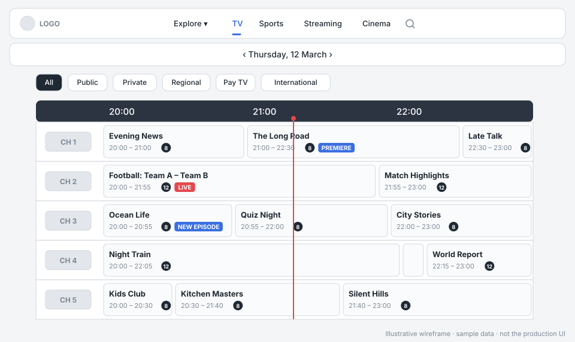
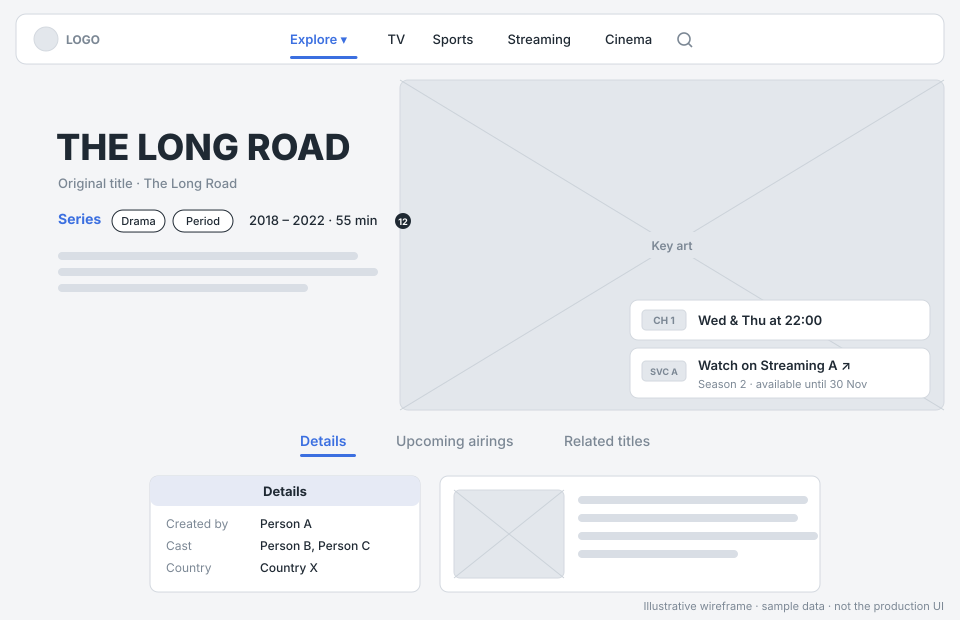
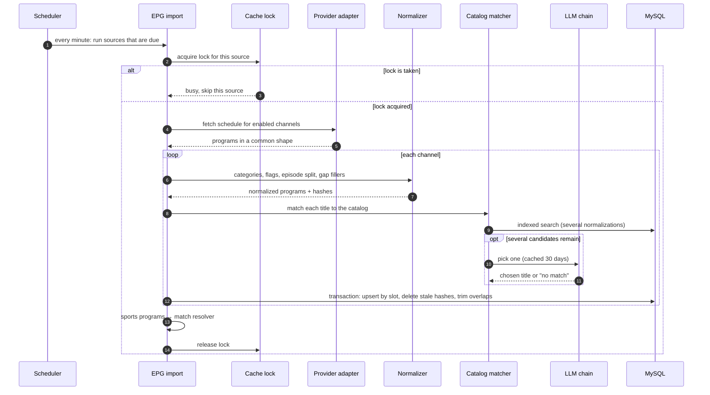
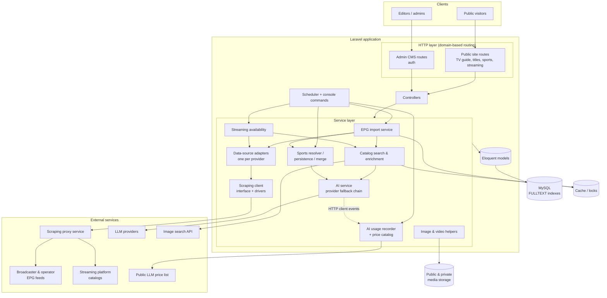
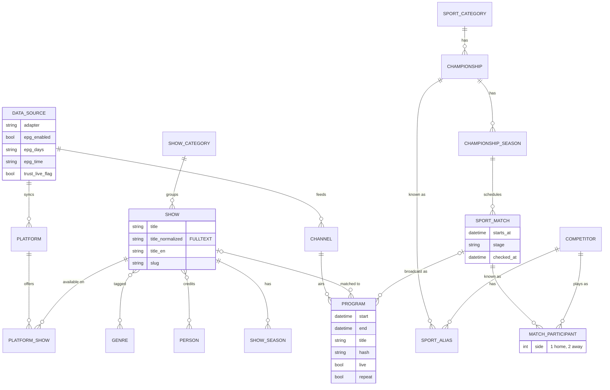

# Case Study: Multi-Source TV & Streaming Guide Platform


A TV and streaming guide I built on my own with Laravel. It pulls schedules from a lot of different providers, each with its own format, and turns them into one clean catalog that people can browse and search.

The source code is private, so this repository is documentation only: it covers how the system is built and why I made the choices I did. Names, data sources and other identifying details have been left out on purpose.

| Duration | Data sources | Models | Migrations | Unit tests |
|:---:|:---:|:---:|:---:|:---:|
| ~1 year | 17 | ~55 | 65+ | 66 |

## Highlights

- I built the whole thing myself: database, backend, front end, admin panel, AI integration, video processing and CI.
- 17 schedule adapters and 9 image adapters feed into a single schedule. The sync is safe to re-run and can't overlap with itself.
- LLMs run in production without running up a bill: free tiers are tried first, answers are cached, low-confidence results are thrown away, and every call is logged with its cost.
- Uploaded video is AES-128 encrypted (HLS), and the admin panel lives on its own domain.

**Skills:** system design, data pipelines, relational modeling and indexing, LLM integration, ffmpeg/HLS, Laravel / PHP 8.3, CI

| TV guide grid | Title page |
|---|---|
|  |  |

<sub>These are wireframes with made-up data, not screenshots of the real site.</sub>

## Contents

- [My Role](#my-role)
- [Overview](#overview)
- [Architecture](#architecture)
- [Key Features](#key-features)
- [Technical Challenges](#technical-challenges)
  1. [Turning many feeds into one schedule](#1-turning-many-feeds-into-one-schedule)
  2. [Matching messy titles to the catalog](#2-matching-messy-titles-to-the-catalog)
  3. [Sports matches without a big AI bill](#3-sports-matches-without-a-big-ai-bill)
  4. [Knowing what the AI actually costs](#4-knowing-what-the-ai-actually-costs)
  5. [Protecting video without paying for DRM](#5-protecting-video-without-paying-for-drm)
- [Security](#security)
- [Testing](#testing)
- [Performance](#performance)

---

## My Role

Personal project, built solo over about a year. I did everything from requirements to deployment: architecture, the database (~55 models, 65+ migrations), every integration, the AI features, the public site, the admin UI, tests and CI.

## Overview

TV schedules (EPG data) come from broadcasters, IPTV operators and satellite platforms, and every one of them publishes it differently. Some have JSON APIs, some only have HTML pages, some only go through smart-TV or set-top-box endpoints. On top of that, the same movie or match is often listed under a different name on each channel. And people don't only watch TV anymore; they also want to know what's on the streaming services.

The platform:

- imports schedules from many sources, each on its own timetable
- normalizes them into one schema (categories, genres, years, advisory flags, episodes split out of combined listings)
- links every broadcast to a single title catalog that fills itself in automatically
- tracks which titles are available on which streaming platform
- recognizes sports broadcasts and marks live matches
- serves a bilingual public site, plus an admin panel for editors

## Architecture

It's a modular monolith. For a solo project one Laravel app made more sense than several services, with the domain logic in a service layer so the controllers stay thin and the logic can be tested on its own.

The public site and the admin panel run from the same codebase on different domains. The service layer covers the EPG import, the provider adapters, catalog matching, streaming availability, sports, AI and scraping. Anything that runs in the background is an Artisan command, started by the scheduler or by hand.

All scraping goes through a single interface with swappable drivers, so the provider adapters never deal with credentials and the scraping backend can be changed without touching them.

### How an import runs



<details>
<summary><b>System diagram</b></summary>



</details>

<details>
<summary><b>Core data model</b> (simplified)</summary>



</details>

<details>
<summary><b>Full tech stack</b></summary>

| Area | Technologies |
|------|--------------|
| Backend | PHP 8.3, Laravel 12.61, Laravel Fortify 1.37 (auth) |
| AI | `laravel/ai` 0.7 (structured output), Google Gemini (free, paid and "Flex" tiers), Groq (OpenAI-compatible), managed image search API |
| Data | MySQL 8 with FULLTEXT indexes, database cache / queue / sessions, atomic cache locks |
| Media | ffmpeg (H.264, AES-128 HLS), Intervention Image 3.11 (WebP variants) |
| Front end | Blade components, Tailwind CSS 4, Vite 7 |
| Quality | PHPUnit 11, Mockery, Laravel Pint, GitHub Actions (PHP 8.3 + MySQL 8) |
| Hosting | Ubuntu server |

</details>

## Key Features

- Each source has its own import days and time, set from the admin panel.
- Categories, genres and production years are worked out from the description text. Multi-episode blocks are split up, and empty slots in the schedule get a "back at HH:MM" filler.
- Content advisory flags are pulled from descriptions, and ratings support more than one national rating system.
- When a broadcast doesn't match any known title, a new title is created and filled in by an LLM and an image search.
- A match shown on several channels is still one match in the database, with its own live flag. Streaming platforms get their own catalog pages and pricing.
- From the admin panel editors manage channels, sources, the catalog and blog posts (with scheduled publishing), and can see what the AI is costing.

## Technical Challenges

### 1. Turning many feeds into one schedule

Every provider has a different format and updates on its own rhythm. Imports can be slow, and running one twice, or two at the same time, must never leave a channel with duplicate or missing programs.

Each provider gets its own adapter that returns the same array shape, so adding a provider is one new class and a row in the admin. Each source also takes its own lock instead of one global lock, so a slow provider doesn't hold up the rest.

<details>
<summary><b>How the sync works</b></summary>

Every program gets a hash of channel, start, end and title. For each channel, inside one transaction, programs are upserted by time slot, anything in the imported time window whose hash is no longer in the feed is deleted, and overlaps are trimmed. Running the same import twice gives exactly the same schedule.

```text
for each due source (skip if locked):
    rows = adapter.fetch(enabled_channels)
    for each channel in rows.group_by(channel):
        transaction:
            normalized = normalize(rows) + gap_fillers(rows)
            upsert normalized by (channel, start), with hash
            delete rows in [min_start, max_end] whose hash is not in normalized
            trim overlaps
```

</details>

### 2. Matching messy titles to the catalog

The same title shows up with or without a subtitle, in two languages, spelled differently. Exact matching missed too much, and fuzzy matching on its own picked the wrong title too often.

So the search runs a few normalization passes over FULLTEXT-indexed columns first. The LLM only gets involved when more than one candidate is left.

<details>
<summary><b>Details</b></summary>

When it does run, the LLM gets the category, year and description and returns its pick as structured output. Providers are tried in order, free tiers first and the paid one last, and the next one is only used if the previous call fails (rate limits, mostly). Answers are cached for 30 days, including "no match". Failures are never cached, and editing one of the candidate titles invalidates the cached answer.

```text
candidates = search(normalizations(title, title_en))
if candidates.count == 1: return candidates[0]
return cache.remember(hash(title, context, candidate_ids), 30 days):
    for provider in [free_a, free_b, paid]:
        try: return provider.pick(candidates, context)
        except failure: continue
```

</details>

### 3. Sports matches without a big AI bill

A single match can air live, delayed and as a repeat on several channels. Figuring out which real match a listing is about needs an LLM with web search, and web search is charged per query.

The cheap path runs first: code finds matches in a time window whose team or player names (or known aliases) appear in the listing, and an LLM without web search picks one. Web search is only used for live airings from trusted sources, or when nothing matches at all.

<details>
<summary><b>Details</b></summary>

- Answers below 60/100 confidence are ignored and retried on the next import.
- Sports categories are a fixed list that the AI can't add to.
- Two matches count as the same one if they start within 30 minutes of each other and have the same competitors.
- A program is marked live if it starts between 60 minutes before and 30 minutes after kickoff and isn't a repeat. The flag is only removed if a corrected kickoff ends up more than 6 hours away.
- An Artisan command merges duplicate categories or championships (with a dry-run mode) and saves the old names as aliases.

</details>

### 4. Knowing what the AI actually costs

With several providers, free and paid tiers, retries and web searches, it was hard to tell what the AI features were really costing.

So I log at the HTTP level instead of inside the AI code. A listener on Laravel's HTTP client events records every request that goes to an AI provider, including retries and failures, and even things the SDK doesn't expose, like the search queries. If the logging itself fails, the AI call still goes through.

<details>
<summary><b>Details</b></summary>

- Each request is tagged with the feature that made it.
- A public price list is synced every day, with manual overrides in config. If a model isn't in the list it's logged as "unpriced" rather than guessed.
- Where the provider offers a cheaper "flex" tier, a custom gateway uses it, retries with exponential backoff while it's busy, and falls back to the normal tier.
- Logs older than 180 days are pruned every night.

</details>

### 5. Protecting video without paying for DRM

A plain video URL can be downloaded by anyone who has it, and proper multi-DRM needs a paid license server.

On upload, ffmpeg converts each video once into AES-128 encrypted HLS. The encrypted segments go to public storage, where they're useless without the key, and the playlist and the 16-byte key go to private storage. When someone plays the video, the key URL in the playlist is swapped for a signed URL that expires quickly.

This stops casual downloading and hotlinking. It is not a replacement for full DRM (nothing stops screen recording, for example), which was an acceptable trade-off for this kind of content.

## Security

Login uses Laravel Fortify with email verification, and there's no public sign-up. Login attempts are rate-limited, and the admin panel runs on its own domain with every route behind authentication.

All input is validated server-side, and secrets live only in environment configuration, never in the code or the database. Video is protected as described in [challenge 5](#5-protecting-video-without-paying-for-drm).

## Testing

There are 66 PHPUnit unit tests, mostly around the parsing logic: EPG parsing, episode and long-program splitting, time helpers, rating enums, and the scraping client (with faked HTTP, so tests never hit a real provider). GitHub Actions runs them on every push and pull request against PHP 8.3 and MySQL 8.

## Performance

- FULLTEXT indexes on the original and normalized title columns, plus regular, unique and foreign-key indexes.
- Shared eager-loading presets for the list and guide queries, to avoid N+1 queries.
- Imports write in chunks, with one transaction per channel.
- AI answers are cached for 30 days, and locks stop imports from overlapping.
- Images are stored as WebP in a few pre-generated sizes.